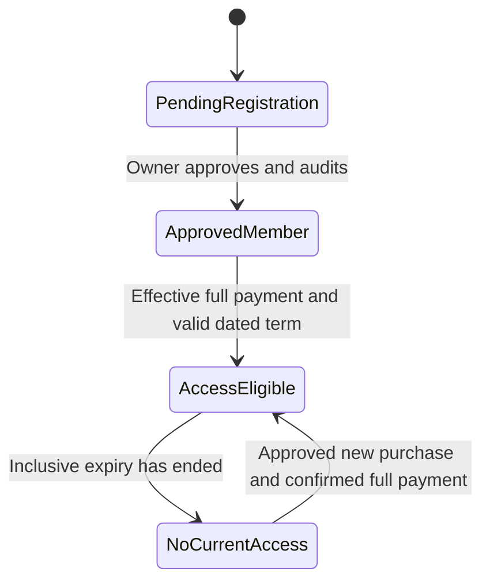

# Foundation and lifecycle review — 2026-11-06

**Verdict: NOT READY for Attendance.** This continues the November 6 checkpoint.
Only a non-destructive safety runner and documentation were added/updated in
this follow-up. No ownership, privilege, migration, schema, business data, UI,
hosted Supabase, or deployment changes were made. Approval is required before
drafting an ownership/lifecycle migration or applying any such change.

## 1. Ownership root cause and solution assessment

Fresh protected-identity/SCRAM preflight matched the approved cluster:
`gymforce_pg18_test`, `127.0.0.1:55432`, PostgreSQL 18.6, marker
`f497fabb-a12f-4068-b745-8b0729279276`, system identifier
`7704603813616068820`, canonical directory
`C:\Users\Banco-Sual\AppData\Local\GYMFORCE-PG18-TEST\data`.

The native migration runner explicitly uses `-U postgres` and requires both
`current_user` and `session_user` to be postgres. The initial migration creates
`public.gym_settings` under that identity. No migration changes application
ownership or switches to a restricted owner. Consequently its owner is
`postgres`. Bootstrap creates dormant restricted roles and minimal Auth
compatibility objects; creating `gym_data_owner` alone changes no table owner.

Fresh catalog evidence:

| Object group | Current state |
|---|---|
| 21 private application tables + `public.gym_settings` | All postgres-owned, RLS enabled, FORCE RLS disabled |
| 3 private identity sequences | postgres-owned |
| 16 API functions, 9 private functions, `auth.uid()` | postgres-owned |
| `private`, `api`, `auth`, `extensions` schemas | postgres-owned |
| `public` schema | owned by `pg_database_owner` |
| Seven harness roles | Restricted attributes as documented; only `gym_registration_login` has LOGIN; no superuser/CREATEDB/CREATEROLE/replication/BYPASSRLS |
| Reserved-role membership edges | Zero |

The assertion file is also partly a **Phase 1 snapshot**, not a final-state
contract for all 24 migrations. Beyond ownership it expects an empty API
schema, only one private helper, authenticated API USAGE with service-role
USAGE denied, dormant executors, and a Supabase GraphQL extension wrapper.
Later migrations deliberately introduce server-only RPCs, revoke authenticated
API access, and grant service-role usage. Adopting the old access expectations
would conflict with the current implementation's security boundary.

Assessment of the four candidate fixes:

| Candidate | Finding |
|---|---|
| Change migration execution identity | Not a standalone fix. The runner intentionally uses a trusted DDL actor. A restricted data owner lacks extension/schema setup privileges, and creating all functions as that owner does not establish an executor/RLS design. |
| Change bootstrap ownership | Not a standalone fix. Application tables do not exist yet at bootstrap. Its Auth shim ownership is explicitly postgres and must remain separately reviewed. |
| Correct test assumptions | Necessary for obsolete Phase 1 shape/API-grant assertions and native-versus-Supabase scope. Keep enduring security invariants and retain the current failure until a replacement contract is approved. Do not simply change the expected owner to postgres. |
| Controlled forward ownership migration | Appropriate if the reviewed target remains data-owner/runtime separation. It needs a full object/execute-grant/RLS-policy matrix, forward-only application, and regression tests. Moving one table cannot complete this work. |

This is a mismatch between the intended hardened design, actual migrations,
and test scope. It is not evidence that a live hosted table has the same
owner, nor proof of browser exposure. Postgres-owned SECURITY DEFINER functions
retain a highly privileged execution identity; that risk remains unresolved.

## 2. Exact review scope before any ownership change

The following are **candidate objects for a reviewed forward migration**, not
authorized ownership changes. The data-owner role would remain NOLOGIN,
NOSUPERUSER, NOCREATEDB, NOCREATEROLE, NOINHERIT, NOREPLICATION, NOBYPASSRLS.

The 22 application tables:

- `public.gym_settings`.
- `private.owner_access`, `private.members`, `private.audit_events`,
  `private.audit_chain_heads`.
- `private.membership_plans`, `private.membership_purchases`.
- `private.payment_records`, `private.payment_allocations`,
  `private.payment_events`, `private.payment_corrections`.
- `private.walkin_fee_versions`, `private.walkin_requests`,
  `private.attendance_checkins`, `private.attendance_validity_resolutions`.
- `private.member_pin_credentials`, `private.member_pin_setup_tokens`,
  `private.pin_attempt_buckets`, `private.pin_enrollment_global_rate_limit_events`.
- `private.cash_drawer_sessions`, `private.cash_reconciliations`,
  `private.cash_reconciliation_adjustments`.

The three associated identity sequences:
`private.audit_events_id_seq`, `private.payment_events_id_seq`, and
`private.pin_enrollment_global_rate_limit_events_id_seq`.

Before any transfer, review the 25 application functions in `api`/`private`,
their 13 triggers, sequence dependencies, default ACLs, and existing server-only
RPC grants. Decide function-by-function whether a restricted runtime identity
is appropriate and exactly what table, column, sequence, function, and RLS
permissions it needs. Preserve explicit active-Owner checks and public PIN
capability verification where applicable. No browser role should gain direct
private-table access or membership in an executor role.

FORCE RLS with no policies will deny operations by a non-superuser data owner;
superuser-owned functions still bypass RLS. Ownership transfer, FORCE RLS,
runtime function ownership, policies, and grants must therefore be designed
together. Do not add permissive policies or BYPASSRLS to hide failures.
Do not use broad `REASSIGN OWNED`, transfer extension objects, or change Auth,
public-schema, database, or unrelated-role ownership as a shortcut.

Recommended next approved deliverable: a forward-migration draft and
phase-aware assertion design covering this exact application-object scope,
with a reviewed least-privilege matrix and regression/rollback strategy.
No executable migration or privileged-change script was prepared in this task.
Local execution and any hosted deployment need separate approval.

## 3. Registration and membership lifecycle

### Current implementation and gaps

| Stage | Actual behavior | Gap |
|---|---|---|
| Registration | Active Owner RPC creates a pending member; server-generated code; encrypted mobile + keyed lookup; atomic audit | No implemented registration approval operation |
| Owner approval | `approved_at` column exists | No operation fills it; active status does not require a non-null approval timestamp |
| Plan selection | Owner-only active plan lookup and purchase creation; member must have active status; price snapshot | Status-only member check does not establish approval time; pending registrations have no implemented path to purchasing |
| Payment recording | Owner-only, operation ID replay check, one unresolved attempt, immutable original facts | Amount mismatch becomes rejected; no complete unmatched/underpaid actual-receipt review/allocation workflow |
| Confirmation | Owner check, full-price equality, evidence review for electronic methods, allocation once, payment/purchase/audit transaction | Confirmation reaches pending_activation; no membership dates assigned; no dedicated immutable confirmed-at field (confirmation events carry server timestamps) |
| Activation/renewal | Date columns and overlap exclusion constraint exist | No implemented date calculation/finalization or serialized renewal operation |
| Expiry | Date/status fields exist | No implemented authoritative eligibility evaluation or expiry transition |
| Cancellation | No status, endpoint, or workflow | Intentionally excluded by requirements; do not introduce it |
| Audit/corrections | Registration, plans, purchase, receipt recording and confirmation/rejection append audit history | Approval, activation, renewal, and payment-void resolution are absent |

The `guard_purchase_pending_activation` trigger only checks entry into
`pending_activation`. It does not establish that every `active`/dated state is
paid, approved, correctly dated, and immutable. Existing checks allow active
status with both dates null, and do not prohibit arbitrary dated states via a
privileged writer. These are source-level invariant gaps, not mutation tests
performed against the existing database. Browser direct access remains denied.

### Proposed state transitions for review

Member registration approval is distinct from paid gym access:



The diagram's access states are derived business conditions, not proposed new
member status strings. Existing `members.status = active` should mean approved
and not security-suspended; it must never itself prove a paid entitlement.
Separate security suspension requires its own approved grounds/evidence path.

Purchase lifecycle: `pending_payment -> pending_activation -> active -> expired`.
The latter transitions remain proposed, not implemented. A confirmation void
requires preserved receipts/audits, an explicit `payment_review`/invalidated
eligibility resolution, and documented handling of related attendance history.
No automatic restoration, refund, cancellation, grace period, or expiry override.

### Required database/server invariants

1. Only a verified active Owner can approve registration or confirm actual
   receipt. Derive actor identity from verified Auth; never trust browser IDs.
   Approval time is server-assigned and audit-linked.
2. No access without approved registration and allocated, effective, full
   confirmed payment. Preserve original receipts, confirmation timestamps,
   amounts, snapshots, actors and reasons. A receipt is allocated at most once.
   Actual received money awaiting allocation remains an accounting/review fact.
3. For a new/expired term, activation is the later Manila date of approval and
   full-payment confirmation. Use confirmation time, not the earlier recorded
   receipt time or client date. Define how later finalization commits that
   already-established date; never backdate for delayed payment confirmation.
4. Expiry is `clamp_calendar_month(activation + 1 month) - 1 day`, inclusive
   through the expiry date. Jan 31 2027 -> Feb 27 2027 expiry; Jan 31 2028 ->
   Feb 28 2028; Feb 28 2027 -> Mar 27 2027; Feb 29 2028 -> Mar 28 2028.
5. An early renewal starts the day after existing inclusive expiry; an expired
   renewal starts from its new activation date. Serialize decisions per member,
   enforce non-overlap and consecutive terms, and reject arbitrary future
   prepaid terms. Precisely define/review the allowable queued-renewal rule
   before encoding it; do not silently permit unlimited advance purchases.
6. Eligible terms require paired valid dates and an approved payment basis.
   Pending unpaid purchases cannot carry access dates. Status labels alone
   cannot bypass date/payment rules, and clock-driven status updates are not
   required to discover that an expiry date has passed.
7. Transitions, term creation, allocation, and audit append commit atomically.
   Recheck approval, suspension and payment effectiveness under locks, with
   idempotent retries. Audit failure rolls back the transition.
8. A later correction/void preserves original transactions and invalidates
   affected eligibility. It must not delete history or silently reactivate
   anything. Cash-drawer received-money accounting stays distinct from income
   and entitlement reports.

These transitions/invariants need approved forward migrations, constrained
RPCs, corresponding Edge wrappers, and tests. They were not implemented here.

## 4. Completed non-destructive safety tests

New runner: [test-safety-guards.ps1](local-testing/test-safety-guards.ps1).
It verifies the exact approved cluster before testing and after completion.
The runner itself exits 0 only when every expected rejection and comparison
passes; unexpected results throw and produce a nonzero PowerShell process exit.

| Negative case | Method | Actual psql exit |
|---|---|---:|
| Wrong expected database | In-memory existing migration-guard copy with mismatching expected name, actual connection unchanged, READ ONLY | 3 |
| Wrong expected endpoint port | In-memory existing migration-guard copy with mismatching expected port, actual connection unchanged, READ ONLY | 3 |
| Wrong execution role | Existing bootstrap target guard under `SET LOCAL ROLE service_role`, READ ONLY; no membership grant | 3 |
| Incorrect bootstrap state | Existing bootstrap against migrated test DB, forced READ ONLY; freshness guard refuses before DDL | 3 |
| Actual wrong database connection | First confirm synthetic name absent; connection to that nonexistent name on the verified cluster | 2 |
| Actual wrong endpoint connection | Hold an exclusive bound, non-listening loopback socket; connect to that reserved closed port | 2 |

No unrelated database/server was queried and the default port was not used.
Wrong-name/port guard simulations are explicitly simulations; they do not
claim a real unapproved cluster was contacted. No fixture tables were created.
The migrated-bootstrap negative never reached role/schema creation.

Before/after fingerprints matched for scoped application data, sequence state,
relations/ACLs/RLS, columns, constraints, indexes, function definitions/owners/
grants, triggers, schemas, policies, default ACLs, roles, and memberships.
They are comparative test evidence, not a tamper-proof whole-cluster backup.
Read-only transactions independently prevent persistent writes in SQL probes.
All connections ended with the intended database and identity still valid.

During construction the runner failed closed on snapshot/SQL transport errors
before its negative cases. Windows native argument handling was avoided by
streaming larger/multiline SQL on stdin. Sequence snapshots now read explicit
state fields because PostgreSQL sequences lack a composite row type. These
were test-runner corrections only; no migration/schema correction was applied.

Reproduce from the project root without changing system execution policy:

```powershell
powershell.exe -NoProfile -ExecutionPolicy Bypass -File .\docs\local-testing\test-safety-guards.ps1
if ($LASTEXITCODE -ne 0) { throw 'Stop: safety suite failed.' }
```

The earlier eight marker/system-ID/path/missing-ID refusal tests and
environment-override rejection are historical checkpoint evidence; they were
not rerun by this six-case runner. Missing/invalid protected files and pgpass
are still rejected by the fresh preflight. Broader credential/ACL fault
injection and hosted/PostgreSQL 17 coverage remain outside this run.

## 5. Validation, files and next approval

Fresh results: lint PASS (0), typecheck PASS (0), build/PWA PASS (0), Deno unit
suite PASS (38/38, 0), payment catalog suite PASS (0), foundation suite FAIL
(3: `public.gym_settings is not owned by gym_data_owner`). No failed assertion
was disabled or rewritten. No migrations were reapplied or databases reset.

Files changed in this follow-up:

- Added `docs/local-testing/test-safety-guards.ps1` for reproducible read-only
  refusal tests and state comparison.
- Added this review for ownership options, exact candidate objects, lifecycle
  transitions, invariants, results and approval boundaries.
- Updated the local-testing README and development checkpoint with these
  results and remaining scope limitations.

Existing `.gitignore` excludes credentials, machine identity, logs, database
files/dumps, caches/build output, scratch text, and UI backups. Test source and
documentation remain explicitly reviewable. No files staged, committed or
pushed. Existing unrelated work remains untouched.

Next approval requested: prepare a **draft only** forward ownership/executor
migration and phase-aware assertion proposal for the listed application
objects. Review its exact policy/grant/function matrix before authorizing any
local application. Lifecycle approval/activation work needs its own reviewed
schema/RPC change. Attendance, hosted changes and ownership execution remain
blocked. The current verdict is **NOT READY**.
